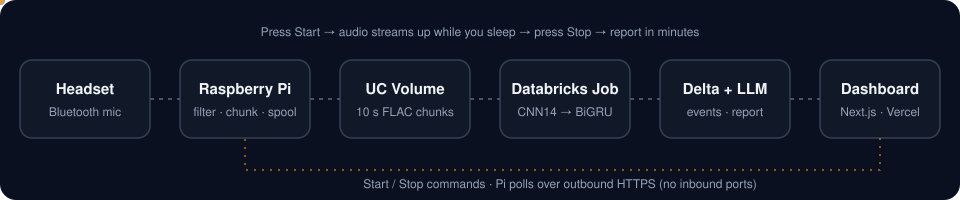
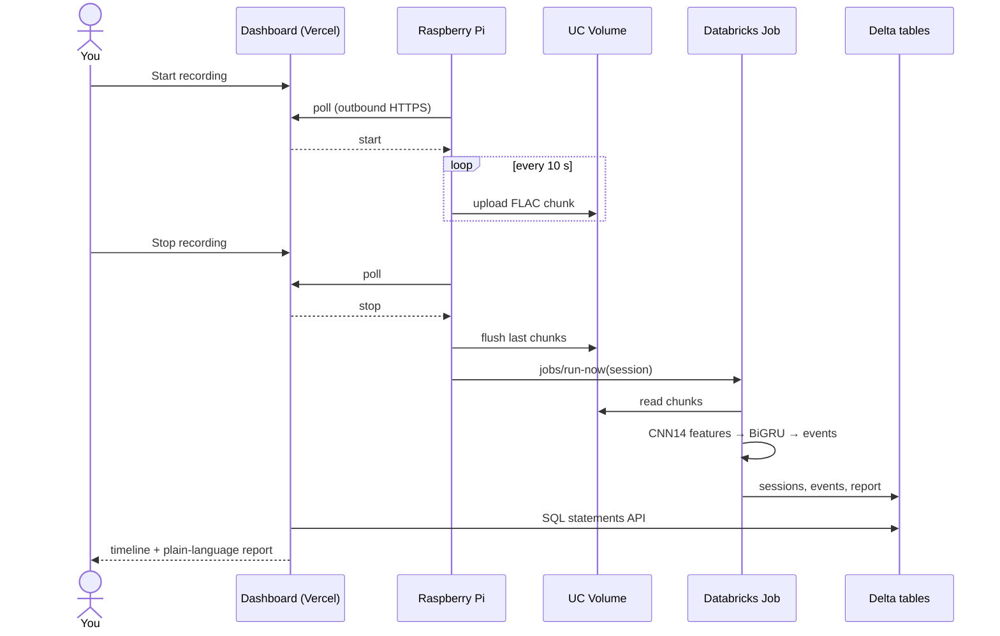

<p align="center">
  
</p>

<p align="center">
  
  
  
  
  
  
</p>

**SleepSafe turns a Bluetooth headset and a Raspberry Pi into an at-home sleep listener.** Press **Start** on a web dashboard, sleep, press **Stop**, and a few minutes later you get a timestamped timeline of breathing pauses, snoring and sleep, plus a plain-language report you can bring to a doctor.

> [!IMPORTANT]
> SleepSafe is a **wellness and screening prototype, not a medical device**. Its breathing-event estimates are not clinically validated and must not be used to diagnose or treat anything.

---

## Contents

- [Why we built it](#why-we-built-it)
- [How it works](#how-it-works)
- [The model](#the-model)
- [Results](#results)
- [Quick start](#quick-start)
- [Databricks deployment](#databricks-deployment)
- [Dashboard data API](#dashboard-data-api)
- [Repository layout](#repository-layout)
- [Challenges and lessons](#challenges-and-lessons)
- [Limitations](#limitations)
- [What's next](#whats-next)
- [Team](#team)

---

## Why we built it

The most important sounds of your night happen while you're asleep. If you're worried about your breathing, it's hard to turn that worry into something concrete to discuss with a clinician, and the cost and hassle of a formal sleep study make the first step feel out of reach.

SleepSafe started from one idea: **make it easy to understand your breathing during sleep, from home.** It helps people notice patterns and ask better questions, without pretending a headset can replace a clinical sleep study.

## How it works

<p align="center">
  
</p>

| Step | What happens | Where |
|:---:|---|---|
| 1 | You press **Start recording** on the dashboard | Next.js on Vercel |
| 2 | The Pi captures the headset mic, resamples to **16 kHz mono**, band-pass filters **60 Hz–7 kHz** (cuts rumble and hiss, keeps quiet breathing) | `pi/agent.py` (PipeWire + FFmpeg) |
| 3 | Audio is spooled locally and uploaded in **10-second chunks** while you sleep, so a Wi-Fi drop loses nothing | `pi/uploader.py` → Unity Catalog Volume |
| 4 | You press **Stop**; the Pi finishes uploading and triggers a serverless job | `jobs/run-now` |
| 5 | The job stitches chunks, normalizes loudness, runs the model and post-processing | `databricks/process_session.py` |
| 6 | Events and a session summary land in **Delta tables**; `databricks-gpt-oss-120b` writes a non-diagnostic report | Delta + Foundation Model API |
| 7 | The dashboard shows events per hour, sleep time, snoring, an interactive timeline and the report | `dashboard/` |

The Pi only makes **outbound HTTPS** requests: it polls for Start/Stop commands and publishes its status, so it needs no open inbound ports. Databricks credentials stay server-side in the dashboard.

<details>
<summary><b>Sequence diagram</b></summary>



</details>

## The model

A two-stage audio model: a frozen, general-purpose sound encoder, plus a small head trained to recognise breathing events.

```
16 kHz audio ─► PANNs CNN14 (frozen) ─► per-second features ─► BiGRU head ─► 4 per-second probabilities
                                                                              apnea · hypopnea · snore · asleep
             ─► post-processing (thresholds, median filter, merge gaps, min durations) ─► timestamped events
```

| Part | What it is | Trained? |
|---|---|:---:|
| Encoder | PANNs **CNN14** 16 kHz (AudioSet), GPU-native log-mel front end | frozen |
| Features per second | 2048-d embedding (PCA → 256) + 12 AudioSet scores + 24 band-energy stats | – |
| Head | Linear → Conv1d → 2-layer **BiGRU** (128) → 4 sigmoid outputs, ~0.6 M params | ✅ |
| Zero-shot flags | cough, gasp, snort, wheeze, speech from AudioSet scores (data-calibrated thresholds) | – |
| Speech gate | AudioSet evidence stops talking from being mistaken for sleep or snoring | – |

**Training data:** [PSG-Audio](https://www.nature.com/articles/s41597-021-00977-w) (Korompili et al., 2021, CC BY 4.0): hospital polysomnography with synchronized ambient and tracheal mics and technician-scored apneas, hypopneas, snoring and sleep stages. **79 subjects**, split **by subject** (59 train / 10 validation / 10 test, stratified by AHI), so the test set contains only people the model never heard. Headset conditions are simulated with GPU augmentation: muffling, clothing rustle, room noise, gain changes and dropouts.

## Results

Held-out test set, 10 unseen subjects, full nights. *These are offline dataset results, not clinical accuracy claims, and not yet validated on consumer headsets.*

| Metric | Ambient mic | Tracheal mic |
|---|:---:|:---:|
| Apnea + hypopnea **event F1** | **0.801** | **0.835** |
| Event precision / recall | 0.844 / 0.762 | 0.863 / 0.808 |
| AHI correlation (Pearson *r*) | 0.896 | 0.910 |
| AHI mean absolute error (events / h) | 7.8 | 6.6 |
| Severity class accuracy (within one class) | 80% (90%) | 80% (90%) |
| Apnea average precision | 0.911 | 0.910 |
| Sleep / wake accuracy | 90.5% | 90.6% |

Short sessions hold up: on **30-minute** windows, ambient-mic event F1 is **0.799**. The speech gate raised snore F1 from **0.42 → 0.47** on held-out recordings while changing fewer than **0.4%** of predicted asleep/apnea seconds. Full numbers are in [`runs/v2/metrics.json`](runs/v2/metrics.json).

## Quick start

Run the trained model on any recording. No retraining needed: the head is committed at `runs/v2/model.pt`.

```bash
pip install torch numpy scipy soundfile requests
python scripts/fetch_encoder.py                                  # once: frozen encoder, 358 MB → data/pretrained/Cnn14_16k.pth
python scripts/run_session.py recording.flac --out night.json --device cpu
```

> [!TIP]
> Record at 16 kHz mono (other rates are resampled) and turn **off** noise suppression, noise gates and automatic gain control. They erase the quiet breathing sounds the model listens for.

<details>
<summary><b>Retrain from scratch (Windows + RTX GPU)</b></summary>

```powershell
uv venv .venv --python 3.12
uv pip install --python .venv\Scripts\python.exe torch torchaudio --index-url https://download.pytorch.org/whl/cu128
uv pip install --python .venv\Scripts\python.exe numpy scipy requests huggingface_hub soundfile
python scripts/download_convert.py --n-subjects 80        # ~275 GB streamed, kept as 16 kHz npy
.venv\Scripts\python scripts/extract_features.py           # GPU, ~1 min per subject (6 augmented variants)
.venv\Scripts\python scripts/train.py --name v1            # GPU-resident training, minutes
.venv\Scripts\python scripts/run_session.py rec.flac --out night.json [--demo-mode]
```

</details>

## Databricks deployment

Runs on Databricks **Free Edition** (serverless CPU only).

| Piece | Where |
|---|---|
| Audio + models | Volume `/Volumes/workspace/default/sleepsafe` (`chunks/<session>/`, `raw/<session>/recording.wav`, `models/`, `reports/`) |
| Processing job | `sleepsafe-process-session` (serverless CPU; report LLM `databricks-gpt-oss-120b`) |
| Tables | `sleepsafe_sessions` (report JSON), `sleepsafe_events` (event JSON), `sleepsafe_reports` (Markdown) |
| Dashboard views | `sleepsafe_v_sessions`, `sleepsafe_v_events`, `sleepsafe_v_event_counts` |
| Companion agent | `sleepsafe-agent` Databricks App: classification and Q&A over session data |
| Data protection | Column masking in Databricks, added after feedback from Xorbix mentors |

```bash
export DATABRICKS_HOST=https://<your-workspace>.cloud.databricks.com DATABRICKS_TOKEN=<token>
python scripts/fetch_encoder.py
python scripts/deploy_databricks.py        # tables, views, model upload, code, job (idempotent)
```

<details>
<summary><b>Process a session</b></summary>

```bash
# live, from the Pi: watches a folder of 10 s chunks and triggers the job when recording stops
python pi/uploader.py --watch-dir /path/to/chunks --volume /Volumes/workspace/default/sleepsafe \
    --job-id <job id> --duration-min 30 [--demo-mode]

# or replay a finished recording through the same path (time-lapse demo)
python scripts/simulate_pi.py recording.wav --session-id demo-night-1 --job-id <job id> --wait
```

See [`pi/README.md`](pi/README.md) for setting the Pi up as a service.

</details>

## Dashboard data API

<details>
<summary><b>REST (Databricks App, read-only)</b></summary>

| Route | Returns |
|---|---|
| `GET /sessions` | one summary row per session, newest first |
| `GET /sessions/{id}/dashboard` | recording, summary, classification, event counts, timeline, report, caveats |
| `GET /sessions/{id}` | full report JSON |
| `GET /sessions/{id}/events?type=apnea` | events |
| `GET /sessions/{id}/report` | LLM-written Markdown report |
| `GET /classify/{id}`, `POST /ask` | the agent's classification and Q&A |

Databricks Apps require a signed-in Databricks user or an OAuth bearer token.

</details>

<details>
<summary><b>SQL (works with a personal access token)</b></summary>

Use `POST /api/2.0/sql/statements` against your SQL warehouse:

```sql
SELECT * FROM workspace.default.sleepsafe_v_sessions ORDER BY start_utc DESC;
SELECT * FROM workspace.default.sleepsafe_v_events WHERE session_id = :sid ORDER BY start_offset_s;
SELECT * FROM workspace.default.sleepsafe_v_event_counts WHERE session_id = :sid;
SELECT report_markdown FROM workspace.default.sleepsafe_reports WHERE session_id = :sid;
```

</details>

## Repository layout

| Path | Contents |
|---|---|
| [`sleepsafe/`](sleepsafe) | Model package: encoder, head, augmentation, labels, post-processing, end-to-end pipeline |
| [`scripts/`](scripts) | Data download, feature extraction, training, local inference, Pi simulation, Databricks deploy |
| [`databricks/`](databricks) | `process_session.py`: the serverless job that turns chunks into events and a report |
| [`pi/`](pi) | Raspberry Pi capture agent, chunk uploader and systemd service |
| [`dashboard/`](dashboard) | Next.js 15 + React 19 + TypeScript dashboard (Vercel) |
| [`runs/v2/`](runs/v2) | Trained head (`model.pt`) and test metrics |
| [`context.md`](context.md) | Full engineering log: design decisions, verification, operations |

## Challenges and lessons

| Challenge | What we did |
|---|---|
| **Hospital mics ≠ consumer headsets.** In an early headset test, talking was mistaken for snoring and sleep. | Added AudioSet evidence gates and checked them on held-out data (snore F1 0.42 → 0.47) |
| **Bluetooth mic profiles and Pi Wi-Fi** were unreliable | Local spooling with continuous 10 s uploads, so a network drop loses nothing |
| **Laptop GPU crashes** mid-training | Finished training on CPU; production inference runs on serverless CPU |
| **Stop-to-report orchestration** across edge and cloud | Pi flushes, then triggers the job itself; the dashboard only reads results |

**What we learned:** a strong model is only one part of a useful health prototype. Microphone quality, reliable uploads, honest uncertainty and a clear explanation matter just as much. We also kept the two models' jobs separate: **the audio model detects patterns; the language model only explains structured findings** and never invents a diagnosis.

**Verified end to end:** an eight-minute reference recording through the Pi's real capture pipeline, with 48 chunks uploaded, the job completed, and the report shown on the dashboard.

## Limitations

- **Screening aid, not a diagnosis.** No clinical validation.
- Trained on **hospital** microphones; a full real-headset sleep validation is still future work.
- **Hypopneas are hard** to detect without blood-oxygen (SpO₂) data (average precision ≈ 0.18–0.29).
- Snore labels are device-scored and sparse; zero-shot flags are not calibrated against labels.
- 30-minute sessions give only a rough events-per-hour estimate.
- Databricks Free Edition is for non-commercial use with no compliance guarantees, so **don't upload real patient data**.

## What's next

<details>
<summary><b>Product direction: wellness first, clinical later</b></summary>

**Near term: wellness.** After talking with Carter from Strato VC, we're focusing first on a wellness product that helps people understand their sleep patterns and night-time sounds. Next steps: evaluate paired headset recordings against reference recordings (noise suppression, fit, false positives, reduced-breathing events), add signal-quality feedback, and test with intended users and sleep-care professionals.

**Longer term: a clinician-directed home assessment.** The ambition is a device a doctor could prescribe for one night at home, with findings the clinician reviews to decide on further testing or care. That would require clinical partnerships, validation studies and the appropriate FDA pathway, and insurance coverage would need its own evidence. **None of these exist today**; they are future milestones, not current capabilities.

</details>

## Team

Built at a hackathon by:

| | Built |
|---|---|
| **[Harihara Nalamotu](https://github.com/HariharaNalamotu)** | Audio model, Databricks pipeline and job, dashboard, Pi agent |
| **Yagya** | `sleepsafe-agent` Databricks App: classification and Q&A |
| **[Nitesh Kothari](https://github.com/nitkots)** | Raspberry Pi audio capture and runbook |

Thanks to **Tyler and Patrick (Xorbix)** for pushing us to build in data protection, and **Carter (Strato VC)** for the wellness-first product advice.

<sub>This repository is a copy of [HariharaNalamotu/SleepSafe](https://github.com/HariharaNalamotu/SleepSafe). Training data: PSG-Audio, CC BY 4.0. PANNs CNN14 weights: Kong et al.</sub>
